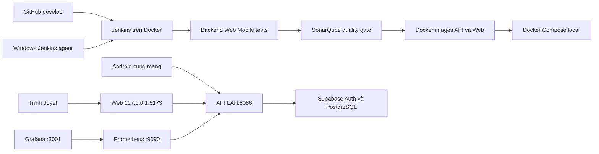

# Triển khai FinSight trên máy cá nhân

## Phạm vi

Máy Windows chạy Docker Desktop và WSL2 theo yêu cầu, nhưng Docker chỉ được khởi động thủ công. Bản demo gồm web tĩnh, Spring Boot API, Prometheus, Grafana, SonarQube và Jenkins. Web/API dùng Supabase Auth và PostgreSQL của dự án hiện có; dữ liệu ứng dụng **không** nằm trong Docker volume. Triển khai lên máy chủ public qua SSH là phần cộng điểm trong mẫu báo cáo và chưa thực hiện.



Jenkins chạy trong container cổng `127.0.0.1:8085`; agent Windows gắn nhãn `windows-finsight` chọn JDK 17 và có Docker CLI. SonarQube chỉ mở trên loopback cổng 9000. Prometheus đọc `/actuator/prometheus` mỗi 15 giây; Grafana tự nạp datasource và dashboard FinSight API. API và web được đóng gói bằng Dockerfile riêng, Compose khai báo healthcheck và chỉ cho web khởi động sau khi API khỏe.

## Chuẩn bị

1. Cài Docker Desktop với WSL2, JDK 17, Node 22, Git và agent Jenkins theo [setup](setup.md). Tắt tùy chọn tự chạy Docker Desktop khi đăng nhập Windows.
2. Tạo `.env` từ `.env.example`. Điền Session pooler, Supabase issuer/JWKS và publishable key của cùng một Supabase project. Thêm mật khẩu riêng cho `GRAFANA_ADMIN_PASSWORD`. Không đưa `.env` hoặc token vào Git.
3. Trong Supabase Authentication → URL Configuration, cho phép `http://127.0.0.1:5173/` làm đích web. Điện thoại Android dùng API LAN `http://<IP máy tính>:8086`, và điện thoại cùng Wi-Fi với máy tính.
4. Chỉ nếu chạy CI: giữ `.secrets/jenkins-admin-password` và `.secrets/jenkins-agent-secret` trên máy; lần đầu đăng nhập SonarQube tại `http://127.0.0.1:9000`, đổi mật khẩu mặc định, tạo global analysis token, lưu token trong Jenkins Credentials với ID `finsight-sonar-token`. Không commit token.

## Khởi động và kiểm tra

```powershell
powershell -ExecutionPolicy Bypass -File .\scripts\start-local-deployment.ps1
```

Thêm `-IncludeCI` để khởi động SonarQube, Jenkins controller và Windows agent. Lần đầu sẽ tải image và build nên mất nhiều thời gian. Các URL:

| Thành phần | URL trên máy |
| --- | --- |
| Web | `http://127.0.0.1:5173/` |
| API health | `http://127.0.0.1:8086/actuator/health` |
| API metrics | `http://127.0.0.1:8086/actuator/prometheus` |
| Prometheus targets | `http://127.0.0.1:9090/targets` |
| Grafana FinSight API | `http://127.0.0.1:3001/d/finsight-api/finsight-api` |
| Jenkins | `http://127.0.0.1:8085/` |
| SonarQube | `http://127.0.0.1:9000/` |

Kiểm tra `health` trả HTTP 200, API nghiệp vụ không có JWT trả 401, Prometheus target `finsight-api` hiển thị `UP`, dashboard Grafana có `API available = 1`. Đăng nhập web với tài khoản demo chỉ sau khi API khỏe. Nếu cổng 5173/8086 đang thuộc tiến trình chạy bản RC2 cũ, hãy dừng các tiến trình đó trước khi khởi động Compose.

Jenkinsfile chạy Maven verify/JUnit và báo cáo JaCoCo, web lint/build, mobile TypeScript/Expo Doctor, build Docker API và web, rồi quét SonarQube bằng token Jenkins Credentials. Quality Gate phải đạt trước khi coi pipeline thành công. Khi chọn `DEPLOY_LOCAL=true` trong Jenkins, stage cuối dùng đường dẫn `LOCAL_ENV_FILE` (mặc định `D:\Codes\finsight\.env`) để triển khai Compose và chạy `scripts/check-local-deployment.ps1`. Có thể chạy SonarQube và Jenkins độc lập bằng hai Compose file trong `infrastructure/docker/`; SonarQube dùng H2 tích hợp cho mục đích demo local, không phải cấu hình dữ liệu lâu dài cho production.

## Dừng

```powershell
powershell -ExecutionPolicy Bypass -File .\scripts\stop-local-deployment.ps1
```

Script dừng agent, các container FinSight, Docker Desktop rồi gọi `wsl --shutdown`. Named volumes giữ lại dashboard và lịch sử phân tích. Nếu còn container của dự án khác, script dừng các thành phần FinSight rồi báo lỗi và **không** tắt Docker/WSL để tránh làm gián đoạn dự án đó; hãy kiểm tra `docker ps` trước khi quyết định dừng các container khác.
